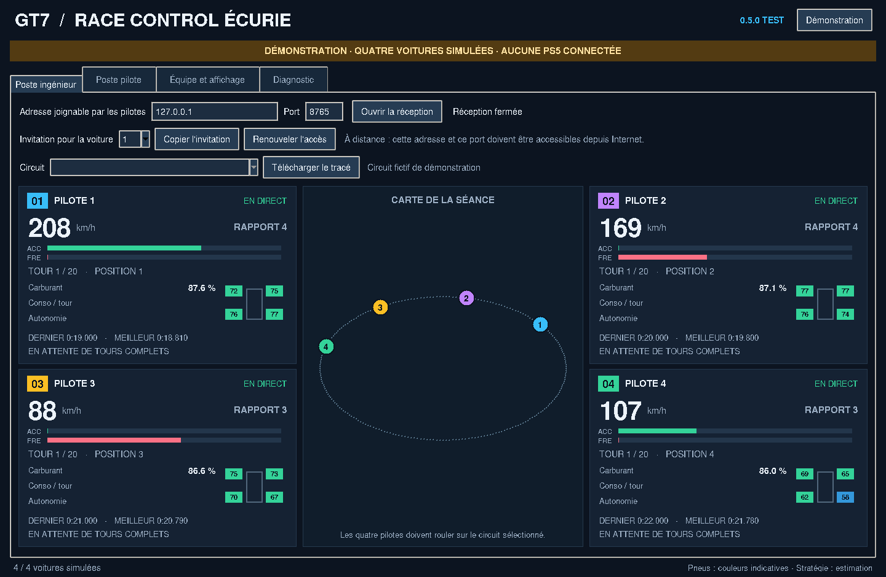
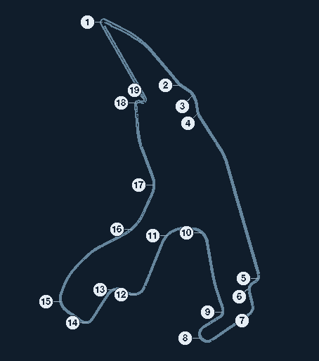

# GT7 Race Control Écurie — 0.8.1 Test

Un poste ingénieur pour réunir les télémétries de **quatre pilotes GT7**, chacun
avec sa PlayStation et son PC Windows. La même application propose un mode
pilote, un mur des stands et une démonstration clairement identifiée.



## Télécharger et lancer sur Windows

1. Télécharger [l'installateur Windows 0.8.1 Test](https://github.com/glili35/GT7-Race-Control-Ecurie/releases/download/test-v0.8.1/GT7-Race-Control-Ecurie-Setup-0.8.1-test.exe), pour une première installation ou pour corriger la mise à jour depuis 0.7/0.8.
2. Arrêter la capture et fermer la version en cours, puis lancer `GT7-Race-Control-Ecurie-Setup-0.8.1-test.exe`.
3. Ouvrir **GT7 Race Control Écurie (Test)** depuis le menu Démarrer.

L'installateur et l'archive portable sont disponibles dans la
[publication Test 0.8.1](https://github.com/glili35/GT7-Race-Control-Ecurie/releases/tag/test-v0.8.1),
sans compte GitHub. Les artifacts de compilation restent disponibles dans Actions.

Les versions 0.7 et 0.8 peuvent refuser un installateur valide avec le message
« L'installateur a changé pendant sa vérification ». Le défaut étant dans leur
lanceur déjà installé, un passage manuel unique à 0.8.1 est nécessaire. Il n'est
pas nécessaire de désinstaller le canal Test ni d'effacer son profil.

Python et les bibliothèques sont inclus dans l'installateur et dans la version
portable : aucune installation séparée de Python n'est nécessaire sur le PC.
L'installateur n'est pas signé.
Le canal Test utilise un dossier et un identifiant différents de la version
historique : il peut être essayé sans la désinstaller.
L'archive `Portable` permet aussi un lancement sans installation. Extraire tout
le ZIP, puis lancer `GT7-Race-Control-Ecurie.exe` depuis le dossier extrait.
Conserver tous les fichiers et sous-dossiers ensemble : copier l'EXE seul ne suffit pas.

Le bouton **Démonstration** présente quatre voitures fictives et une carte fictive,
sans connexion PS5, transmission réseau ni enregistrement de session.
Un bandeau indique ce mode en permanence.

La version 0.8.1 met à jour le canal Test existant en conservant son profil.
La réception PS5 et l'essai complet sur un seul PC de la version 0.6 ont été
confirmés par l'utilisateur. La version 0.8.1 conserve ces fonctions ainsi que
le relais optionnel de 0.8, dont le parcours peut être essayé sur un seul PC.

## Mises à jour depuis le logiciel

Après le passage manuel à 0.8.1, utiliser le bouton **Mises à jour** pour les
publications suivantes :

1. Cliquer **Mises à jour**, ou ouvrir l'onglet du même nom.
2. Le logiciel vérifie les publications publiques du canal Test. S'il est à jour,
   la version courante est indiquée ; sinon, les évolutions proposées apparaissent.
3. Arrêter les captures et la réception, puis cliquer **Télécharger et installer**.
4. Le logiciel télécharge le fichier, vérifie sa taille et son empreinte, puis
   ouvre l'assistant Windows. L'application se ferme après le lancement réussi
   de l'installateur. Terminer l'assistant pour rouvrir la nouvelle version.

Le bouton existe depuis 0.7 ; le contrôle de fichier sous Windows est corrigé
dans 0.8.1. Les versions suivantes pourront être récupérées depuis ce bouton, sans passer
par les pages GitHub. Aucun téléchargement ni lancement n'est effectué au démarrage.
La recherche et le téléchargement s'exécutent en arrière-plan ; le téléchargement
peut être annulé. Si une capture démarre entre-temps, le fichier reste prêt et
l'installation attend son arrêt et la fermeture complète du CSV.

Les sessions, circuits, invitations et réglages restent dans le même profil local.
La publication reste un canal de test, distinct d'une version stable officielle.

## Premier essai avec une PS5

1. Sur le PC pilote, ouvrir **Poste pilote**.
2. Renseigner l'IPv4 de la PS5, sur le même réseau que le PC. Un champ vide
   active la recherche par diffusion UDP locale ; celle-ci dépend du réseau.
3. Laisser l'invitation vide pour commencer par un essai local.
4. Cocher l'enregistrement CSV, puis **Connecter la PS5**.
5. Dans GT7, rouler sur la piste. Le compteur doit augmenter et les données
   apparaître dans **Poste ingénieur**, qui sert aussi d'aperçu local.
6. Arrêter la connexion pour fermer le CSV. **Ouvrir le dossier des sessions**
   donne accès aux données enregistrées.

Autoriser l'application dans le pare-feu Windows sur le réseau privé si Windows
le demande. GT7 utilise UDP 33739 vers la PS5 et UDP 33740 en réception sur le PC.
Fermer les autres logiciels qui utilisent ces ports pendant l'essai.
L'état PS5 indique la réception de données valides ; l'état de transmission
indique séparément si le poste ingénieur reçoit les données.

## Vérifier toute la chaîne avec un seul PC

1. Ouvrir **Poste pilote** et renseigner l'IP de la PS5 comme pour l'essai précédent.
2. Arrêter une éventuelle connexion ou la démonstration.
3. Choisir **Direct** ou **Relais local**, puis cliquer **Démarrer l'essai complet** et rouler dans GT7.
4. Vérifier que le statut affiche **Chaîne locale complète en direct**, puis
   retrouver la voiture dans **Poste ingénieur**.

L'application ouvre une réception chiffrée accessible uniquement sur ce PC et
crée son invitation automatiquement. Les données de la vraie PS5 traversent
le transport choisi avant d'alimenter le mur des stands : l'affichage ingénieur
ne reçoit pas de copie directe de la capture. Aucune donnée fictive n'est injectée.
L'invitation saisie pour l'équipe reste inchangée et les CSV gardent la fréquence
locale complète. Le bouton **Arrêter l'essai complet** ferme les deux côtés.

**Direct** vérifie le transport HTTPS existant. **Relais local** démarre un
relais temporaire sur la boucle locale : pilote et ingénieur s'y connectent
séparément en WebSocket, avec chiffrement de bout en bout des mesures. Le relais
ne reçoit pas les clés. Ses accès temporaires sont supprimés à l'arrêt ; les CSV
restent dans le dossier des sessions. Aucun hébergement distant n'est nécessaire
pour cet essai.

Cet essai vérifie la chaîne sur un seul ordinateur. Il ne valide pas l'accès
depuis un autre domicile, le routeur ou le pare-feu d'un autre PC.

## Connecter l'ingénieur et les quatre pilotes

En mode **Connexion directe**, sur le poste ingénieur :

1. Renseigner une **adresse joignable par les pilotes** et le port, 8765 par défaut.
2. Cliquer **Ouvrir la réception**.
3. Choisir la voiture 1, puis **Copier l'invitation** et la transmettre au pilote 1.
4. Refaire l'opération avec les voitures 2, 3 et 4. Chaque invitation donne accès
   uniquement à sa voiture. **Renouveler l'accès** révoque son ancienne invitation.
5. Dans **Équipe et affichage**, nommer les pilotes. Sélectionner le circuit
   de la séance et télécharger son tracé s'il est disponible.

Sur chaque poste pilote, coller son invitation dans **Poste pilote**, renseigner
l'adresse locale de sa propre PS5, puis connecter. Le numéro distant vient de
l'invitation ; le sélecteur de voiture ne concerne que l'aperçu local.

Le bouton **Vérifier l'invitation** contrôle l'adresse, le certificat et l'accès
avant même le roulage. Il distingue invitation invalide/révoquée, certificat
différent et ingénieur injoignable, sans créer de fausse voiture connectée.
Les deux postes doivent utiliser 0.6 ou ultérieure pour cette vérification ; le transport
de télémétrie existant reste compatible avec 0.5.

**Depuis plusieurs domiciles**, l'adresse de l'ingénieur doit être accessible
depuis Internet. Une adresse privée `192.168.*`, `10.*` ou `172.16–31.*` ne suffit
pas à elle seule. Une solution consiste à utiliser une adresse publique/DNS et
une redirection TCP du port choisi vers le PC ingénieur, avec le pare-feu adapté.
Avec un accès Internet sous CGNAT, il faut un relais hébergé ou un réseau privé
configuré séparément. Cette version ne provisionne aucun relais ni abonnement
et ne modifie pas le routeur automatiquement.

### Utiliser un relais hébergé

Cette option permet aux deux côtés d'établir une connexion sortante ; le PC
ingénieur n'a alors pas besoin d'une redirection de port entrant. Elle exige
un relais effectivement déployé et une adresse WSS avec certificat reconnu.
La version 0.8 fournit le serveur et les clients, sans hébergement préconfiguré.
Voir [la configuration du serveur](docs/RELAIS.md).

1. Dans **Poste ingénieur**, choisir **Relais hébergé**.
2. Renseigner son adresse et le code d'accès ingénieur fourni par l'administrateur,
   puis **Connecter le relais**. Le profil local conserve ensuite l'accès à sa salle.
3. Copier une invitation distincte pour chacune des quatre voitures.
4. Chaque pilote colle son invitation et connecte sa propre PS5 comme en mode direct.

Les deux postes doivent utiliser 0.8 ou ultérieure pour le relais. Les mesures
sont chiffrées de bout en bout avec une clé différente par voiture ; le relais
ne conserve que les accès et ne stocke pas d'historique de télémétrie.
**Renouveler l'accès** révoque l'invitation de la voiture choisie et crée une
nouvelle clé. Le bouton de vérification contrôle l'accès sans envoyer de mesure.

En mode direct, les quatre flux voyagent en HTTPS. L'invitation contient l'empreinte du certificat
de l'ingénieur, vérifiée avant l'envoi du jeton d'accès. Les invitations et les
clés restent dans le profil local : ne pas les publier dans un ticket GitHub.

## Fonctions de cette version

- Mur des stands de quatre voitures, carte commune et numéros colorés.
- Disposition adaptée : à deux voitures, une de chaque côté ; à quatre, deux
  de chaque côté. Les voitures dont le signal est perdu restent identifiées.
- Vitesse, rapport, accélérateur vert, frein rouge, carburant en pourcentage,
  quatre températures de pneus, chronos, tour et position.
- Consommation moyenne et autonomie **indépendantes par voiture**, exprimées en
  pourcentage du réservoir. Premier tour partiel, ravitaillements et ruptures de
  séance sont exclus des estimations. Leur caractère provisoire est affiché.
- Réception locale et CSV à la fréquence des paquets, environ 60 Hz selon GT7.
  Transmission à l'ingénieur plafonnée à 10 Hz, sans bloquer la capture locale.
- Détection de perte de signal et masquage des mesures périmées.
- États distincts pour le roulage, la pause, le chargement et le retour hors piste.
  Chargement et hors piste masquent les mesures et les positions ; la pause
  suspend l'apprentissage de consommation. Le statut de connexion reste séparé.
- Prise en compte des ravitaillements progressifs et horodatage CSV à la réception,
  même lorsque l'écriture disque est retardée.
- Catalogue embarqué de 122 configurations, dont 27 avec données de bordures
  dans ce catalogue ; bouton **Tous les tracés (27)** pour les installer ensemble.
  Les caches valides sont conservés et chaque échec est signalé séparément.
- Proposition du circuit à partir des coordonnées réelles, parmi les tracés
  installés. Les variantes géométriquement identiques restent à choisir.
- Noms des pilotes, rotation de carte et miroir horizontal enregistrables.
  Le miroir est activé par défaut pour corriger le sens du tracé GT7 ; le même
  changement s'applique aux voitures, sans modifier leurs coordonnées réelles.
- Numéros de virage affichés lorsque la bibliothèque fournit leurs coordonnées :
  notamment 19 à Spa et 11 à Monza. Le bouton **Virages** sur la carte permet
  de les masquer. Les annotations disponibles couvrent actuellement 10 tracés ;
  aucun numéro n'est créé pour les tracés non annotés.
- Accès à l'ancienne interface V4, conservée pour comparaison.

Les points de bordure ne sont pas reliés arbitrairement : les fichiers de la
bibliothèque ne garantissent pas leur ordre. Les quatre pilotes doivent rouler
sur le circuit sélectionné.

Les points d'ancrage des numéros subissent le même miroir et la même rotation
que le tracé et les voitures. Les pastilles sont décalées légèrement pour rester
lisibles et reliées à leur position par un trait.



Pour obtenir une proposition, installer les tracés, cocher **Reconnaître le
circuit**, puis parcourir plusieurs virages. La reconnaissance reste locale,
attend plusieurs positions espacées et n'invente pas les circuits absents.
Choisir la configuration proposée puis **Appliquer** ; en cas d'ambiguïté,
sélectionner la variante voulue dans la liste. Il n'y a pas de changement
automatique de carte sur une simple position.

Les couleurs des pneus sont indicatives. La stratégie carburant estime des
besoins sur les courses au nombre de tours ; elle ne décide pas d'un arrêt et ne
modélise pas encore la fin des courses chronométrées. Le déplacement libre des
widgets et une publication stable restent à faire.

## Données et configuration

La nouvelle application stocke son profil dans
`%APPDATA%\GT7-Race-Control-Ecurie-Test` sous Windows. On y trouve les préférences,
les sessions CSV, les circuits téléchargés et l'identité de réception.
Le code source ne contient ni sessions personnelles ni adresse PS5 prédéfinie.
`GT7RC_DATA_DIR` permet de choisir un autre profil, notamment pour les tests.

L'ancienne interface V4 conserve son propre comportement de configuration.

## Développement

Python 3.12 et Tkinter sont utilisés pour le développement et la compilation.

```powershell
py -3.12 -m venv .venv
.\.venv\Scripts\python -m pip install -r requirements.txt
.\.venv\Scripts\python -m unittest discover -s tests -v
.\.venv\Scripts\python racecontrol_app.py
# Aperçu sans PS5 :
.\.venv\Scripts\python racecontrol_app.py --demo
```

Pour construire sous Windows : `./build_windows.ps1`, puis compiler `installer.iss`
avec Inno Setup 6. Le workflow GitHub effectue ces étapes automatiquement.

Les tests couvrent protocole, décodeur, stratégies, cache de circuits, cycle de
capture/CSV, transport TLS, reconnaissance et une chaîne UDP chiffrée → quatre
clients HTTPS → flotte ingénieur. Le contrôleur d'essai sur un seul PC est aussi
testé avec des sockets TLS réels. Ces tests utilisent des paquets synthétiques : **ce ne sont pas des
essais avec quatre PS5 réelles ni une validation Internet**.

La chaîne Windows vérifie aussi que l'EXE portable et l'EXE installé ouvrent
réellement l'interface et produisent un rapport de démarrage. La compilation
seule ne suffit pas à valider le logiciel en course.

Les tests des mises à jour couvrent notamment les fichiers altérés, les versions
antérieures, l'annulation, les sessions en cours et le lancement de l'installateur.
Après les contrôles Windows, le CI publie une préversion immuable sur le commit
testé puis utilise le vrai client, sans authentification, pour télécharger et
vérifier l'installateur public. Il n'exécute pas cet installateur une deuxième fois.

Pour publier une évolution, augmenter le numéro de version et les noms de fichiers
dans le packaging, faire valider la branche puis l'intégrer à `main`. La publication
est réservée aux poussées sur `main` après les contrôles. Une version déjà publiée
n'est jamais écrasée : son tag et ses fichiers doivent rester identiques.

Source du catalogue :
[GT7 Datalogger Track Data](https://github.com/jbhoorasingh/gt7-datalogger-track-data),
licence CC0 1.0 pour ces données. Le jeu et les marques appartiennent à leurs
propriétaires respectifs.
